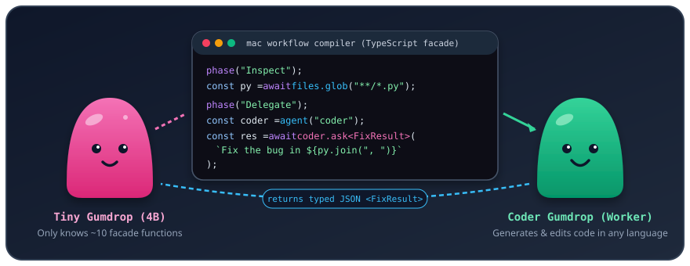

# MAC
### multi-agent-compiler

**mac** is a workflow-compiled agentic coding system where a tiny orchestrator model directs stronger coding agents through a ~10-function TypeScript facade instead of burning tokens in an unstructured chat loop.

---

## How `mac` Generates Code (The Two-Gumdrop Model)



```text
      .-"""-.                                                .-"""-.
     /       \        coder.ask<FixResult>("Fix bug...")    /       \
    |  o   o  |  ----------------------------------------> |  o   o  |
    |   \_/   |                                            |   \_/   |
    '---------'  <---------------------------------------- '---------'
   Pink Gumdrop       { fixed: true, filesModified: [...] }  Mint Gumdrop
 (4B Orchestrator)                                          (Coder Agent)
```

Instead of forcing one model to both manage the workflow and write all the application code—or letting a large model burn thousands of tokens guessing how the workflow harness works—**mac** splits the job between two gumdrop agents:

1. **The Pink Gumdrop (Tiny 4B Orchestrator):**
   * It never edits files directly.
   * All it has to know is **~10 global facade functions** (`phase`, `files.glob`, `files.read`, `files.grep`, `git.status`, `git.diff`, `agent`, `coder.ask<T>`, `world.run`, `log`).
   * Because the surface is tiny and closed, a small 4B model fine-tuned on the facade writes a clean workflow script on the first try—with no giant manual stuffed into the prompt.
2. **The `mac` Workflow Compiler & Engine:**
   * Typechecks the orchestrator's script in memory, synthesizes a JSON Schema for every `.ask<T>()` call, builds the static execution graph, lowers every call to durable journaled host operations, and runs the script in an isolated VM cell.
3. **The Mint Gumdrop (Coder Agent):**
   * Created whenever the workflow calls `const coder = agent("coder")` and invoked via `await coder.ask<T>(instructions)`.
   * Has full coding tools (`Read`, `Write`, `Edit`, `ApplyPatch`, `Bash`, `Grep`, `Glob`) to read, generate, and test code in **any language** (Python, Rust, Go, C++, JavaScript, TypeScript, etc.).
   * When finished, its reply is validated against the compiler-synthesized JSON Schema for `T` and returned to the Pink Gumdrop's workflow script.

---

## Visual Walkthrough: One Task End-to-End

Suppose you run **mac** on a broken Python repository:

```bash
mac run "Fix the bugs in inventory.py and checkout.py so python3 test_store.py passes."
```

### Step 1: The Pink Gumdrop writes a 15-line workflow script

```ts
interface FixResult {
  fixed: boolean;
  filesModified: string[];
  summary: string;
}

phase("Inspect");
const pyFiles = await files.glob("**/*.py");
log(`Found ${pyFiles.length} Python files`);

phase("Delegate");
const coder = agent("coder", {
  system: "You are a senior Python engineer. Read the files, fix the bug, and run the tests.",
});
let result = await coder.ask<FixResult>(
  `Fix the bugs in inventory.py and checkout.py so python3 test_store.py passes. Files: ${pyFiles.join(", ")}`
);

phase("Verify");
const testRun = await world.run("python3", ["test_store.py"]);
if (testRun.exitCode !== 0) {
  result = await coder.ask<FixResult>(
    `python3 test_store.py failed (exit ${testRun.exitCode}):\n${testRun.stdout}\n${testRun.stderr}\nFix the remaining issue.`
  );
}
return result;
```

### Step 2: `mac` compiles the script and synthesizes schemas
* `mac` verifies there are no `import`/`export` leaks or untyped `any` holes.
* `mac` automatically synthesizes the JSON Schema for `FixResult` (`{ fixed: boolean, filesModified: string[], summary: string }`).
* Every facade call gets a deterministic journal site ID (`world-read#1`, `actor#1`, `ask#1`, `world-read#2`).

### Step 3: The Mint Gumdrop generates the code
* When the engine hits `ask#1` (`coder.ask<FixResult>(...)`), the Mint Gumdrop (`gpt-5.5` or your configured coding model) wakes up, reads `inventory.py`, `checkout.py`, and `test_store.py`, edits the files, runs the tests, and returns:
  ```json
  {
    "fixed": true,
    "filesModified": ["inventory.py", "checkout.py"],
    "summary": "Fixed inventory reservation and checkout tax calculation. Tests pass."
  }
  ```

### Step 4: `mac` verifies and journals every receipt
* The workflow continues to `world-read#2` (`world.run("python3", ["test_store.py"])`), confirms `exitCode === 0`, and records every node and file/command effect in SQLite.
* If verification fails or the workflow needs adjustment, `mac` supports `amend_workflow`, which replays completed `files.*`/`git.*` reads and unchanged `ask` nodes directly from the SQLite journal cache (`ImportedRunCache`) without re-running them.

---

## The ~10 Facade Functions

| Function | What it does |
| :--- | :--- |
| `phase(name)` | Marks a named stage in the workflow execution graph |
| `files.glob(pattern)` | Lists workspace-relative files matching a glob |
| `files.read(path)` | Reads a workspace file as UTF-8 text |
| `files.grep(pattern, glob?)` | Searches file contents with a regex |
| `git.status()` / `git.diff()` | Read-only views of working tree status and diffs |
| `agent(name, persona?)` | Spawns a subagent gumdrop that keeps its conversation across asks |
| `coder.ask<T>(instructions)` | Sends a coding task to a gumdrop and validates its JSON reply against `T` |
| `world.run(cmd, args?)` | Runs a build or test command (`python3`, `pytest`, `node`, `cargo`, `go`, etc.) |
| `log(msg)` / `report(item)` | Streams progress and records structured findings in the run journal |

---

## Quick Start

```bash
# Node 24.14.0 + pnpm 10.33.2 (via Corepack)
corepack pnpm install
corepack pnpm -r --sort build

# Run a task through the mac orchestrator -> worker workflow loop
node packages/facade-cli/dist/main.js run --workspace /path/to/repo "Fix the failing tests"

# Start an interactive mac REPL session
node packages/facade-cli/dist/main.js repl --workspace /path/to/repo

# Inspect journaled workflow nodes and tool effect receipts
node packages/facade-cli/dist/main.js inspect --workspace /path/to/repo

# Run the test suites (including the live 4B Orchestrator -> gpt-5.5 Worker E2E test)
corepack pnpm --filter "@zfacade/*" test
```
